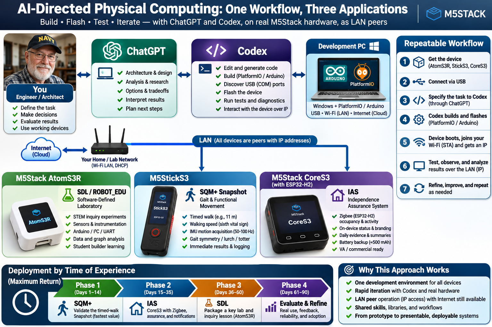

# SDL / RobotEDU - Wi-Fi Instrumentation and 50 Hz ATOM Monitor

Part of the **SDL / RobotEDU education product strategy**: programmable instruments, laboratory experiments, robotics, and browser-based measurement and analysis. The broader goal is a **Vernier-like instrument-and-software experience**, extended to student-built devices and AI-assisted development.

This repository provides the Wi-Fi acquisition gateway and browser analysis foundation, including a verified **50 Hz accelerometer monitor for the original M5Stack ATOM Matrix 1.0 / MPU6886**.



*Broader product and development workflow. Hardware results below cover the original ATOM Matrix 1.0; other pictured applications describe the wider strategy.*

## What it does

- **50 Hz acquisition:** dedicated FreeRTOS sampler and bounded queue.
- **Visible data quality:** CRC32, sequence gaps, errors, RTT, RSSI and browser delivery loss.
- **Responsive browser:** capture every delivered reading, redraw charts at up to 10 Hz, export raw ms/mg as CSV or JSON.
- **Education workflow:** synthetic CORE 10 experiments alongside physical instrumentation.

**Data path:** ATOM TCP server → Python gateway → WebSocket → browser. The PC serves the dashboard. USB is optional during normal Wi-Fi operation.

## Quick start - Windows

Requires Python **3.10+** (tested with 3.14) and a modern browser. Normal runtime uses Python's standard library; no Docker, Node.js, pip packages or cloud account is required.

```powershell
git clone https://github.com/RandoSY/SDL_CORE10_v0.6_WiFiGateway.git
cd SDL_CORE10_v0.6_WiFiGateway
```

### Physical ATOM monitor

Use an ATOM already running the included gateway firmware, powered and connected to the same LAN. Firmware build/flash instructions are in the [runbook](RUNBOOK.md).

```powershell
$atomAddress = "192.168.0.213"  # Replace with your ATOM's current IP address.
py -3 start_accelerometer.py --node-host $atomAddress --save-node --open-browser
```

Later, double-click **START_ACCELEROMETER.bat**. Monitor: [localhost:8799/accelerometer.html](http://127.0.0.1:8799/accelerometer.html).

### Demo without hardware

```powershell
.\START_DEMO.bat
```

Dashboard: [localhost:8788](http://127.0.0.1:8788/). Follow [Start Here](docs/00_START_HERE.md) to record an experiment. Demo measurements are explicitly synthetic.

| Service | Endpoint |
|---|---|
| ATOM instrument TCP | Device IP, port **8766** |
| Physical monitor / status | PC port **8799**; `/accelerometer.html`, `/api/status` |
| Synthetic demo dashboard | PC port **8788** |

## Verified results

- Firmware **0.6.4**: **751 samples / 15.02 seconds / 50.00 Hz**, with zero measured gaps, skips, queue drops, CRC/parse errors or test-client delivery drops in that window.
- User-observed browser responsiveness improved substantially, with a solid displayed 50 Hz.
- **35 Python tests and 9 JavaScript tests passed**, most recently November 10, 2026.

Long-duration losslessness and calibration remain unverified. Later uncontrolled operation recorded queue overflows; see the [bench record](docs/07_ATOM_BENCH_RESULTS.md) for scope and limits.

## Documentation and source map

| Start with | Contents |
|---|---|
| [Building M5Stack products with Codex](docs/09_BUILDING_M5STACK_WITH_CODEX.md) | Candid working method, build loop, lessons learned and reusable starter instruction |
| [Programmer's guide - PDF](output/pdf/ATOM_Matrix_1_0_Programmers_Guide.pdf) | 16 pages; design rationale, 42 file/line references, numbered code excerpts and commands |
| [Runbook](RUNBOOK.md) | Startup, configuration, build, flash, test and recovery commands |
| [Hardware and LED reference](docs/06_ATOM_MATRIX_1_0.md) | Board target, pins and state-based matrix display |
| [Detailed responsiveness design](docs/08_ATOM_RESPONSIVENESS_DESIGN.md) | Sampler, queues, Python bridge, browser rendering and overflow policies |
| [Validation report - PDF](output/pdf/ATOM_Matrix_1_0_50Hz_Validation_Report.pdf) | Original timed physical measurement and fingerprints |
| [Experiment ledger](experiments/atom-performance.jsonl) | Machine-readable measurements and operator observations |

Firmware: `arduino/SDL_ATOM_Gateway_Node/` · Gateway: `gateway/` · Browser: `web/` · Tests: `tests/` · Measurement/report tools: `scripts/`.

## Run the tests

```powershell
py -3 -B -m unittest discover -s tests -q
node --test tests/test_accelerometer.cjs tests/test_browser_delivery.cjs
```

Node.js is optional for JS tests/measurement. USB bench helpers need pyserial; other tool requirements are in the runbook.

## Configuration and included files

Credentials, local settings, configured firmware binaries, raw logs and temporary files stay local. Configuration examples: `accelerometer_settings.example.json` and `arduino/SDL_ATOM_Gateway_Node/wifi_config.example.h`. The monitor command saves your local endpoint automatically.

Source, tests, images, reports, the historical release ZIP and experiment summaries are included. Follow current Markdown; historical PDFs/evidence retain original workstation paths. Source bytes are preserved for recorded fingerprints.

This component supports the larger SDL / RobotEDU platform. Its TCP/WebSocket implementation currently runs separately from the historical SUPER SDL v0.7 MCP service. The browser server binds to localhost.
