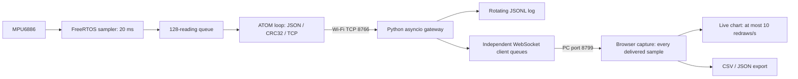

# ATOM Matrix 1.0: how the responsive 50 Hz path works

Documented November 9, 2026. Scope: original **ATOM Matrix hardware 1.0**, firmware **0.6.4**, MPU6886, and the dedicated accelerometer browser monitor. This is the engineering explanation of the current implementation. Build and operating commands live in [RUNBOOK.md](../RUNBOOK.md); measurements and historical failures live in [the bench record](07_ATOM_BENCH_RESULTS.md).

The [PDF programmer's guide](../output/pdf/ATOM_Matrix_1_0_Programmers_Guide.pdf) includes this explanation plus dynamically resolved file/line references, selected numbered source excerpts, operating commands and source fingerprints. Regenerate it with `py -3 -B scripts/build_atom_programmers_guide.py`; source references are resolved from the actual files on each build.

The important change is separation of work with different timing needs. The ATOM measures on a fixed schedule, a bounded queue absorbs temporary publishing delays, Python validates and distributes readings, and the browser captures readings independently of chart redraws. Raising a sample-rate constant alone did not produce the same result.

The user reports “far far better responsiveness at solid 50 hz” and specifically confirms the improved snap of the browser displays. This is valuable user acceptance of the operating system as a whole. The measurements below support sample cadence and delivery; no browser frame-time or motion-to-screen latency benchmark was performed.

## 1. The complete running path

The ATOM is a **TCP server** on port **8766**. Python is its TCP client. Python also serves the browser files and `/ws/telemetry` on local PC port **8799**. The ATOM does not serve this dashboard and does not need to know port 8799. Its persistent TCP stream contains CRC-protected newline-delimited JSON, one envelope per reading; this is not repeated browser HTTP polling of the ESP32.

The original synthetic demo remains a separate entrypoint on port 8788. The dedicated monitor prevents synthetic science presets and their units from being mistaken for physical acceleration measurements.

USB is optional for normal operation. The device needs power and Wi-Fi; Python needs a working network route to the saved device endpoint. COM30 is used only when an operator explicitly runs setup, flashing, or serial diagnostics. No cloud service is involved in the telemetry path.

## 2. What changed and why it matters

| Area | Implemented behavior | Practical effect / qualification |
|---|---|---|
| Acquisition scheduling | Dedicated FreeRTOS task, 20 ms period, priority 2, pinned to core 1 | Network work no longer determines when the acquisition function gets called; scheduler and sensor limits still apply |
| Buffering | 128 `Reading` structures passed through a FreeRTOS queue | Temporary publishing delays can be absorbed without making the sampler wait for TCP |
| Data identity | Timestamp and sequence assigned by acquisition, retained through publication | Buffered data remain identifiable as older measurements; gaps cannot be hidden by renumbering |
| Main-loop work | At most eight queued readings consumed per loop; incoming commands capped at 256 bytes per loop | Limits the amount of work attempted per pass; a blocking socket operation can still delay a pass |
| Radio / socket setup | Wi-Fi sleep disabled, peer TCP no-delay enabled, RSSI cached for one second | Avoids power-save waiting and unnecessary repeated radio queries; individual contributions were not separately benchmarked |
| Device matrix | State-based renderer, checked every 50 ms, pixel write only when image changes | Retains useful activity feedback while avoiding redundant LED transfers |
| Gateway | Async read/ping tasks, validation, recovery deadlines, independent browser queues | Centralizes supervision and keeps a slow browser from directly blocking every other browser's delivery |
| Browser | Capture before throttled redraw; chart refresh limited to 100 ms intervals | Preserves incoming measurements while reducing repeated canvas and DOM work |
| Recovery | Saved Wi-Fi endpoint, optional USB discovery, target-aware instance reuse | Restores a usable startup path after the DHCP change without making USB an operational dependency |
| Evidence | Sequence/drop counters, timing peaks, structured experiment ledger and exports | Improvements and failures can be compared against recorded observations |

These changes operate together. There was no controlled experiment isolating the speedup from each row, and Python itself was not benchmarked against another bridge implementation.

## 3. ATOM acquisition: the timing-critical part

Implementation: [`SDL_ATOM_Gateway_Node.ino`](../arduino/SDL_ATOM_Gateway_Node/SDL_ATOM_Gateway_Node.ino), especially `acquisitionTask()`, `sample()`, `setup()`, and `loop()`.

### Fixed cadence instead of work-duration-dependent cadence

`acquisitionTask()` uses `vTaskDelayUntil()` with `pdMS_TO_TICKS(20)`. Its wake schedule advances relative to the previous target time. A simple delay after all sensor/network/display work would instead add that work's duration to every period and allow the schedule to drift.

The task is created with `xTaskCreatePinnedToCore(..., 4096, ..., 2, ..., 1)`: 4096-byte stack allocation in this ESP32 API, priority 2, core 1. The sampler and publisher are separate tasks; this does **not** imply they run on different processor cores. The existing Arduino loop remains responsible for networking, publication, button handling, the matrix and serial diagnostics.

FreeRTOS is supplied by the installed ESP32 Arduino framework. The sketch includes `Arduino.h`; that installed header brings in the FreeRTOS task and semaphore headers. In this workspace, inspect lines **33-35** of `C:\Users\rasyoung\AppData\Local\Arduino15\packages\m5stack\hardware\esp32\3.3.8\cores\esp32\Arduino.h`: they include `freertos/FreeRTOS.h`, `freertos/task.h`, and `freertos/semphr.h`. No separately installed RTOS or Python-side thread creates the device's sampling schedule. The recorded build uses Arduino CLI, FQBN `m5stack:esp32:m5stack_atom`, M5Stack ESP32 core **3.3.8**, and Adafruit NeoPixel **1.15.5**.

After initial sensor setup, the sampler owns the recurring MPU6886 register reads. Each reading contains acquisition uptime, sequence, X/Y/Z acceleration in mg, magnitude in mg, and validity. The wire stream currently publishes **magnitude only**, not three independent axis channels. `x` and `mono_ms` retain acquisition uptime in milliseconds; `y` is magnitude in milli-g. Network reception time is a separate observation.

### A bounded queue with explicit overflow behavior

`xQueueCreate(128, sizeof(Reading))` creates the bridge between acquisition and publication. At 50 readings/s, 128 readings represent approximately **2.56 seconds** of nominal buffering. This is capacity, not a latency guarantee or an offline recorder.

The sampler calls `xQueueSend(..., 0)`, with zero waiting time. If the queue is full, the **new reading is dropped**, `queueDropped` increases, and the sampler proceeds to its next scheduled acquisition. Previously queued readings are retained. Consequently, a backlog can preserve sample continuity while temporarily increasing sample age; a smooth received stream alone does not prove low latency.

If a task wake is late by one or more whole periods, the code advances the schedule and sequence by those missed opportunities and increments `samplerSkipped`. It does not generate invented measurements to fill missed deadlines. The sampler's counters and acquisition peak are atomic because the publisher reads them from another task.

The loop consumes up to eight readings per pass and serializes valid readings only when a TCP peer exists. While disconnected, the loop still drains readings without transmitting them. Acquisition sequence continues. Reconnection can therefore reveal expected gaps; the queue does not retain an entire disconnected experiment for replay.

### Work kept outside the sampler

The sampler does not construct JSON, calculate envelope CRCs, write sockets, update LEDs, query RSSI, or print status. Those operations have different and less predictable costs than acquiring a sensor reading. The firmware caches RSSI at one-second intervals and uses `peer.setNoDelay(true)` and `WiFi.setSleep(false)` in the transport setup.

This separation protects acquisition from ordinary publisher delays. It cannot make every operation bounded by 20 ms: I2C has its own timeout, scheduling can be delayed, and the publisher can still stall long enough to overflow the queue. Button and matrix work remain in that publisher loop, so their worst-case latency is not established by the 50 Hz sampling pass.

## 4. Rational LED feedback with limited overhead

Implementation: [`matrix_status.h`](../arduino/SDL_ATOM_Gateway_Node/matrix_status.h) and `display()` in the sketch. The [full legend](06_ATOM_MATRIX_1_0.md#matrix-legend) is the operator reference.

The matrix reflects actual state: white startup plus; red sensor-fault X; amber configuration/joining states; blue Wi-Fi-ready outline; cyan connected-peer outline; green outline after recent valid ping/pong handling. A green center indicates a successful **local sample write**, white indicates a recent ping response, violet indicates the held button, and red indicates a recent local communication error. A local write is not an acknowledgement of Python validation or browser display.

The renderer is a pure state-to-pixels function. `display()` considers updates at most every 50 ms and compares the proposed frame with the previous frame before calling `pixels.show()`. Brightness is 20/255. There are no display animation sleeps in the acquisition path.

At 50 Hz, a 120 ms sample pulse is continuously renewed, so its center pixel may look steady. That is consistent with sustained traffic. The green outline specifically reflects recent ping/pong activity, not merely the existence of a Wi-Fi association.

## 5. Why the Python bridge helps this architecture

Implementation: [`gateway/server.py`](../gateway/server.py), especially `connect_device()`, `read_device()`, `ping_device()`, `handle_device()`, `WSClient`, and `status()`.

The bridge keeps browser hosting, per-client delivery, data validation and logging on the PC. The ATOM maintains one instrument connection rather than separately serving every browser. Multiple browser clients can attach to Python without each taking ownership of the ATOM's single TCP peer slot.

Python uses `asyncio` tasks for device reception, ping supervision and browser writes. This is cooperative asynchronous I/O, not an assertion that every stage has a dedicated OS thread. It does not create the device's 50 Hz cadence or recover readings that were never acquired.

Each browser has a **128-message** queue. When full, its **oldest queued message is evicted** so newer messages can be delivered. This is deliberately different from the ATOM queue's drop-new-reading behavior. Browser queues contain diagnostics as well as samples, so they do not have exactly 2.56 seconds of coverage. Drop counts are attached when frames are written and identify the affected connection. One slow browser has its own counters rather than silently imposing its backlog on every client.

The bridge checks the envelope CRC, message fields and sequence continuity before forwarding accepted samples. Invalid data, duplicates, reordering, missing sequence values and browser queue evictions have separate counters. CRC is an application integrity check, not a security/authentication mechanism or proof of accurate sensing.

Recovery uses a three-second TCP establishment limit, the default ten-second read/ping deadline, cleanup of read/ping tasks and a 1.5-second reconnect delay. RSSI/clock/rate observations clear when the link or identity changes. Same-boot sequence continuity is preserved across reconnections, so intervening loss stays visible. See [the reliability contract](05_GATEWAY_RELIABILITY.md) for exact limits.

Accepted samples are logged under `logs/accelerometer/`, with a 20 MiB threshold and one previous rotated file. Logging errors are visible and later writes retry. Logging is still synchronous and best effort: slow storage can delay the event loop, and logs are not an unlimited or guaranteed durable archive.

## 6. Browser responsiveness: preserve data, reduce drawing work

Implementation: [`accelerometer.js`](../web/accelerometer.js), [`accelerometer.html`](../web/accelerometer.html), and [`accelerometer.css`](../web/accelerometer.css).

For each valid physical sample, `sample()` updates the last-sample identity and, while recording, appends the raw point **before** calling `renderView()`. The renderer then returns early if fewer than 100 ms have elapsed. Thus, 50 delivered readings per second can enter the capture while the chart normally redraws at most ten times per second. A redraw includes all retained points in its current plot window; it does not reduce the exported data to ten points per second.

This reduces repeated canvas sizing, grid construction, point drawing and DOM updates. Resize and explicit refresh operations may force a redraw; browser timer throttling or scheduling can reduce the actual display rate. The capture rate, plot redraw rate and dashboard rate-label update cadence are separate quantities. The rate label comes from gateway metrics over a **five-second receive window**, not a hard-coded “50” or a browser animation counter. It can briefly read 50.2 Hz because of window boundaries.

The monitor accepts only `simulated=false`, channel `acceleration_magnitude`, unit `mg`, finite values and a valid sequence. It retains raw device milliseconds and node/boot identity. Pause/resume, reboot and connection transitions create separate capture segments, preserving earlier rows for export without drawing one continuous trace across those boundaries.

The browser retains at most **4096 rows**, approximately 81.92 seconds at 50 Hz; older evictions are counted. The chart shows the latest **60 seconds of the active segment**. Neither limit makes the browser an indefinite recorder. Export important trials before clearing or refreshing, and account for gateway log rotation during longer trials.

CSV/JSON exports preserve timestamps, values, identity, segment, receive time and known capture-loss information. The five-second rest check requires sufficient elapsed device time, values within 900–1100 mg, and sample SD no more than 20 mg. It is a functional rest check, not calibration or proof that no samples are missing.

WebSocket reconnection retries after two seconds and retains captured rows. Counters report known queue loss; they do not reconstruct samples lost during a disconnected interval or acknowledge that a person saw every reading.

## 7. What the evidence establishes

The canonical machine-readable record is [`experiments/atom-performance.jsonl`](../experiments/atom-performance.jsonl). Record kinds and counter scopes matter when comparing entries.

| Observation | Result | Interpretation |
|---|---|---|
| Initial physical functional check, 500 ms period | 21 accepted readings; TCP reconnect passed | Established the original 2 Hz physical path, not high-rate performance |
| Firmware 0.6.3, coupled-loop 50 Hz attempt | Last 500 accepted readings averaged 48.54 Hz; 15 gaps; other snapshots around 40–42 Hz | Reconstructed baseline; no matched-duration controlled comparison or retained source fingerprint |
| Firmware 0.6.4, timed physical stream | 751 readings in 15.02 s; device and receiver rates 50.00 Hz; median/p95/max device intervals 20 ms | No sequence gaps, sampler skips, queue drops, CRC/parse errors or test-client queue drops in that window |
| Later uncontrolled operation since the same boot | 479 cumulative queue drops, zero sampler skips; publishing peak 3.660139 s | Long-run losslessness is not established; these are not losses within the earlier passing window |
| Thirty-second physical reconnect check | 1420 readings; final rolling 50 Hz; successful reconnect; 76 expected gaps during deliberate disconnect; queue-drop delta zero | Confirms recovery; the whole test is intentionally interrupted, not a continuous 50 Hz acceptance window |
| Wi-Fi-only gateway restart at .213 | 500 additional accepted readings over a 10-second observation; final rolling 50 Hz; new-process missing/CRC/parse counts zero; RTT 9.89 ms; RSSI -74 dBm | Confirms restored live operation without serial access; firmware queue counters were not read |
| User acceptance after restart | Browser snap and solid displayed 50 Hz explicitly confirmed | Real operator feedback; no quantitative browser latency percentile measured |

The 15-second pass recorded unchanged since-boot stage peaks: acquisition 2.232 ms, network handling 3.716 ms, publishing 1962.551 ms, display 1.143 ms. The later publishing peak exceeded the queue's nominal capacity. These are maxima, not medians or p95 values, and the publishing stage includes construction plus writes. Its precise bottleneck has not been isolated.

The [formal three-page PDF](../output/pdf/ATOM_Matrix_1_0_50Hz_Validation_Report.pdf) documents the original short passing measurement and its source/binary SHA-256 fingerprints. It remains a historical report of that window. The later observations here and in the bench record qualify it; it has not been silently rewritten as an overnight reliability claim. The generator checks the recorded sketch and binary hashes, not a complete reproducible-build manifest of every dependency.

Automated evidence currently comprises **35 passing Python tests** and **9 passing JavaScript behavior tests**. The Python suite includes seven startup/endpoint regressions. The JS tests cover physical source validation, raw-data export, segments, 50 Hz ingestion, elapsed-time-based rest checking and counted retention eviction. They execute actual scripts with DOM substitutes; they are not graphical frame-rate measurements. Native renderer assertions and physical build/flash checks are separately recorded in the bench history.

## 8. Startup recovery and the DHCP correction

[`start_accelerometer.py`](../start_accelerometer.py) resolves an explicit `--node-host` first, optional `--discover-usb` second, or saved `accelerometer_settings.json` for normal startup ([format example](../accelerometer_settings.example.json)). The actual endpoint file is local and ignored by Git. `--save-node` persists the selected endpoint. The saved current address is `192.168.0.213`; the previous .214 address became stale after DHCP changed.

A running gateway keeps the endpoint selected when it started. Editing settings cannot retarget that process. The browser launcher reuses an existing monitor only if its node identity, connected state and configured host match. It does not silently terminate a mismatched process. `/api/status` exposes `node_host` and `node_port` for inspection.

After the user reset the agent and requested another attempt, the scoped stale-process stop succeeded and gateway PID 26736 started with the saved endpoint. The ten-second window above confirmed delivery. No firmware flash, USB access, firewall change or router configuration change was required.

Current firmware does not advertise an mDNS name. A hostname works only when the actual network resolves it. A DHCP reservation or another supported stable-address arrangement can prevent another stale numeric endpoint, but neither was configured in this work.

## 9. Preserve this behavior in future changes

1. Keep acquisition as the owner of measurement time and sequence. Preserve raw values and units through every stage.
2. Keep JSON, networking, logging, display work and variable-duration callbacks outside the sampler. Measure their costs before adding them.
3. Keep buffers bounded; document each overflow policy and count actual overflow. Increasing capacity alone can hide growing latency.
4. Ingest every accepted browser reading before deciding whether a redraw is due. Retain loss and eviction metadata in exports.
5. Measure cadence, sample age, receiver rate, browser loss, and UI responsiveness separately. A 50 Hz label does not prove low end-to-end delay.
6. Compare experiments using the same duration, configuration, identity, source/build fingerprints and counter deltas. Preserve unique experimental records.
7. Preserve state-based matrix feedback and Wi-Fi-only startup. Treat USB as an optional instrument for diagnosis.

For M5Stick S3, ATOM 1.1, ESP32-C3 or C6, transfer these principles only after checking sensor, framework, pin, memory and scheduling differences. Do not copy this core-1 pinning blindly onto another target. **No implementation or hardware validation on those boards is included here.**

Remaining work is a controlled longer soak, isolation of publishing stalls, quantitative UI/button latency measurement and handling of device-clock rollover for continuous sessions spanning roughly 49.7 days. Preserve the responsive working baseline while investigating those items.

## 10. Source and evidence map

| File / entrypoint | Responsibility |
|---|---|
| `arduino/SDL_ATOM_Gateway_Node/SDL_ATOM_Gateway_Node.ino` | Sensor initialization, sampler, queue, node TCP protocol, timing counters and loop |
| `arduino/SDL_ATOM_Gateway_Node/matrix_status.h` | Pure state-to-pixels renderer |
| `gateway/server.py` | TCP supervision, validation, sequence metrics, browser queues, HTTP/WebSocket and logs |
| `web/accelerometer.js` | Physical-source capture, render throttling, segments, rest check and exports |
| `start_accelerometer.py`, `START_ACCELEROMETER.bat` | Wi-Fi-only startup and optional setup discovery |
| `tests/test_accelerometer.cjs`, `tests/test_browser_delivery.cjs` | Nine browser behavior regressions |
| `tests/test_gateway_reliability.py`, `tests/test_start_accelerometer.py` | Gateway recovery/validation and startup regressions; other original tests remain in `tests/` |
| `scripts/measure_accelerometer.cjs` | Fifteen-second physical stream through actual monitor JS; optional serial timing evidence; ledger append and recall |
| `scripts/check_atom_node.py` | Explicit USB-assisted physical TCP/reconnect bench, with unique experiment evidence |
| `experiments/atom-performance.jsonl` | Historical measurements, counter scopes, observations and known fingerprints |
| `scripts/build_atom_report.py` | Generates the historical formal report after checking recorded sketch/binary hashes |

Use [the runbook](../RUNBOOK.md) for exact commands. Ordinary monitoring needs neither Node.js nor pyserial; measurement helpers have their own additional requirements. Do not run the direct node reconnect bench concurrently with the live monitor: the ATOM supports one TCP peer. Do not open COM30 from two tools at once.
