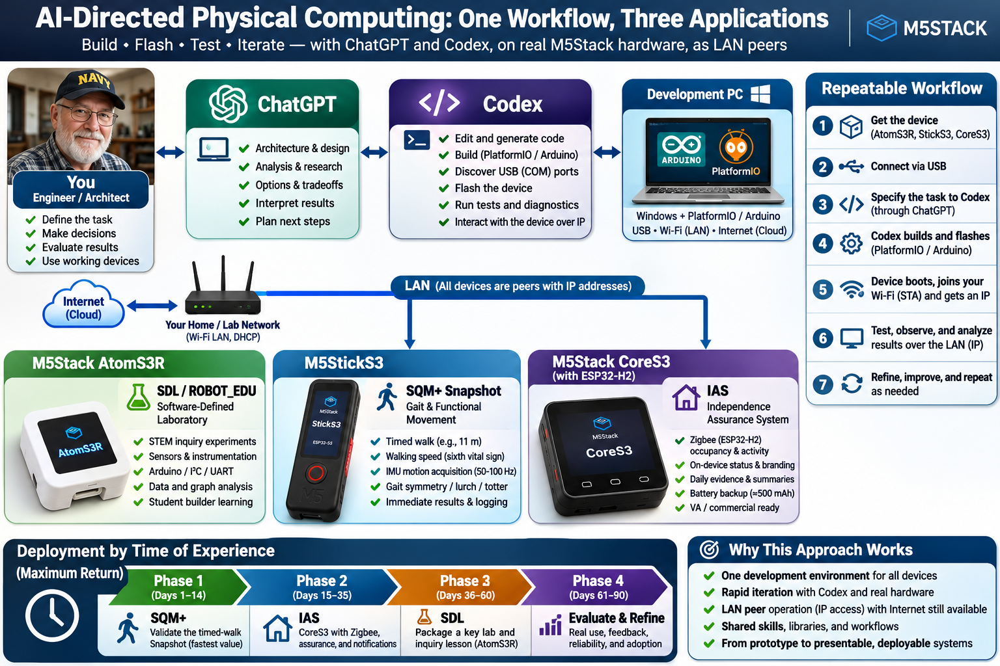

# How I build with Codex and M5Stack ESP32 hardware

RandoSY's working approach, documented with Codex on November 10, 2026. This is an account of a real project, including mistakes and limits, rather than a claim that an AI can independently certify hardware.



## The product goal

I am building toward an **SDL / RobotEDU education platform**: instruments, experiments, data acquisition, graphing, analysis and robotics. The meta goal is a **Vernier-like instrument-and-software experience**, with room for student-built devices and AI-assisted development. This repository provides part of that foundation. It does not establish complete product parity or validation of every application pictured above.

## How we divide the work

I define the practical problem, choose priorities, connect the hardware, authorize consequential changes, and judge the result. I also provide observations the assistant cannot infer from a compiler: whether an LED is actually visible, a button was pressed, an instrument moved, or a browser feels responsive.

Conversation helps us explore architecture and tradeoffs. Codex works against the actual repository and, when the session's tools and permissions allow it, runs the installed compiler, shell, tests, serial diagnostics and network checks. The useful result is the combination of code, device behavior, measurements and human judgment.

I expect autonomous progress on authorized work, concise status, and candor. A proposed command is not an executed command. A successful compile is not a successful flash. A successful flash is not proof of correct physical behavior.

## The repeatable build loop

1. **Establish identity and state.** Confirm the board release, chip, sensor, pins, project path, port and toolchain. Read applicable instructions, `SESSION_STATE.md`, `RUNBOOK.md` and Git status. An original ATOM Matrix 1.0 is a specific target, not an interchangeable AtomS3.
2. **Define an observable outcome.** For this project: acquire real acceleration at 50 Hz, preserve actual timestamps and units, expose loss, and provide a responsive browser display.
3. **Inspect before replacing.** Reuse working drivers and behavior. Make one coherent change and keep the last verified baseline recoverable. Avoid redundant project copies and routine build archives.
4. **Build with the recorded configuration.** Inspect errors and relevant warnings. Record the command and result. Do not keep repeating a failing command without a reason to expect a different outcome.
5. **Flash when authorized.** Verify the exact board, port and artifact. Preserve settings and unique data. For this device, 115200 baud worked after faster upload attempts failed. No full erase was needed.
6. **Test the physical path.** Observe boot, sensor response, Wi-Fi, TCP, sample continuity, browser delivery and recovery. Keep device timing separate from receipt rate and screen updates.
7. **Record and communicate.** Save measured results and a compact checkpoint. Explain what changed, what passed, what remains unverified, and the next useful action.

Optional `AGENTS.md` guidance can make working agreements persistent; OpenAI documents that convention. Our `SESSION_STATE.md` and `RUNBOOK.md` are project conventions, not special files Codex requires. We reuse them rather than generating a new document hierarchy for every task. See [OpenAI's development-workflow guidance](https://developers.openai.com/cookbook/examples/codex/iterating-development-workflows-with-codex).

## Build this reference implementation

The verified target is **original ATOM Matrix hardware 1.0 / ESP32-PICO-D4 / MPU6886**. Recorded tools include M5Stack ESP32 core **3.3.8**, Adafruit NeoPixel **1.15.5**, Python **3.14**, and Node **22.20**. The project runtime targets Python 3.10+; that older-version range was not fully exercised.

After installing the required Arduino components, build from the repository root:

```powershell
arduino-cli compile --fqbn m5stack:esp32:m5stack_atom --jobs 8 --build-path artifacts/atom-build --output-dir artifacts/atom-bin --warnings default arduino/SDL_ATOM_Gateway_Node
```

Use [RUNBOOK.md](../RUNBOOK.md) for the exact flash command and recovery details. A local `wifi_config.local.h` can configure station credentials; [the example header](../arduino/SDL_ATOM_Gateway_Node/wifi_config.example.h) shows the format. With no local header, the firmware attempts saved station settings. Configured firmware can contain credential strings and must stay local.

For normal operation, power the ATOM and connect the PC to the same LAN:

```powershell
$atomAddress = "192.168.0.213"  # Replace with your device's current IP.
py -3 start_accelerometer.py --node-host $atomAddress --save-node --open-browser
```

The ATOM serves instrument TCP on **8766**. Python connects to it and serves the monitor at **http://127.0.0.1:8799/accelerometer.html**. The ATOM does not need to know browser port 8799. USB is a setup and diagnostic convenience, not a runtime requirement. Development may use online AI services; this telemetry path runs locally without a cloud service.

## Where the improvement actually came from

The important change was separating work with different timing requirements:

- **Device acquisition:** a dedicated FreeRTOS task reads the sensor every 20 ms. The installed ESP32 Arduino framework already supplies FreeRTOS; we did not add a separate RTOS installation.
- **Device buffering:** a 128-reading queue carries original timestamps and sequences to the publishing loop. Its nominal capacity is 2.56 seconds at 50 Hz. Full-queue drops and missed acquisition opportunities are counted.
- **Transport supervision:** Python validates CRCs and fields, tracks identity and sequence, supervises ping/pong recovery, logs accepted data and gives each browser a separate bounded queue.
- **Browser presentation:** every delivered sample enters an active capture before the normal 100 ms redraw gate. Fifty measurements per second do not require fifty complete chart redraws per second.
- **Useful device feedback:** the matrix reflects sensor, Wi-Fi, peer and recent traffic state, with redundant pixel writes avoided. A green center indicates a local sample write, not acknowledgement of browser display.

The source index and numbered excerpts are in the [16-page programmer's guide](../output/pdf/ATOM_Matrix_1_0_Programmers_Guide.pdf). The [editable technical explanation](08_ATOM_RESPONSIVENESS_DESIGN.md) describes queue policies, scheduling and remaining limits.

## What went wrong, and what we learned

| Experience | What we changed or learned |
|---|---|
| Raising a shared-loop rate to 50 Hz still produced gaps | Moved acquisition into its own periodic task; a rate constant alone did not isolate it from publishing stalls |
| Ping worked while the agent could not open LAN TCP | Distinguished local execution/network denial from a refused device listener; effective access later changed and the same physical test passed without firewall changes |
| A full-flash backup attempt delayed the immediate goal | Stopped it at my direction; no valid full backup is claimed. Preserve irreplaceable data, but do not create routine backup/build clutter |
| Default address discovery temporarily depended on USB | Corrected it: saved or explicit Wi-Fi endpoint by default; serial discovery only when explicitly requested |
| DHCP changed the ATOM address while the old gateway kept its original endpoint | Verified the current address and restarted only the stale gateway. Editing settings does not retarget an existing process |
| Queue buffering protected a short test but later cumulative drops appeared | Kept the short PASS scoped to its measured window; did not turn it into an overnight losslessness claim |
| Graphical automation was unavailable | Tested actual browser JS with substitutes and recorded my visible responsiveness feedback separately from automated measurements |

Codex can take an unhelpful detour or make an assumption that needs correction. I steer it back toward the engineering outcome. The assistant should acknowledge the correction, make the smallest credible fix, and update the record. Confidence is not evidence.

## What we can honestly claim

The timed physical test received **751 samples in 15.02 seconds at 50.00 Hz**. Device interval median, p95 and maximum were 20 ms in that window. Measured sequence gaps, sampler skips, queue drops, CRC/parse errors and test-client delivery drops were zero. I subsequently confirmed substantially better browser snap and a solid displayed 50 Hz.

That does not establish calibrated accuracy, indefinite lossless capture, or a motion-to-screen latency percentile. Later uncontrolled operation recorded **479 cumulative queue drops** and a publishing-stage maximum of about **3.660 seconds**, exceeding the queue's nominal capacity. Publishing, button latency, clock rollover and a controlled longer soak remain work to do. Those limits do not erase the short measured improvement; they define its scope.

The latest publication checks passed **35 Python tests and 9 JavaScript tests**. Tests using synthetic loopback instruments are distinguished from real-device checks. Evidence lives in [the bench record](07_ATOM_BENCH_RESULTS.md) and [structured experiment ledger](../experiments/atom-performance.jsonl).

## Communication I expect

Useful updates identify the present result and what the next check will resolve. They do not repeatedly say that work is continuing without evidence. Errors should include the important command/error, a grounded explanation and the correction. Tool restrictions should be described plainly; permission from the user and effective execution access are different facts.

At a stopping point, I want **Changed / Verified / Unresolved / Next**. Before a reset or shutdown, save the checkpoint and say whether anything is still running or unpushed. A shutdown stops the PC gateway; a separately powered ATOM may continue sampling, but this firmware is not an offline data recorder.

Before public publication, review the actual staged contents, including nested archives. In this project the published source preserves exact bytes for measured fingerprints; credentials, configured binaries, local settings, raw logs and temporary renderings stay local. The public PDFs and summary ledger preserve the useful findings.

## A starter instruction for the next device

```text
Work as my autonomous pair engineer on this M5Stack/ESP32 project.
Read applicable instructions, SESSION_STATE.md, RUNBOOK.md and Git status.
Establish the exact board release, sensor, pins, toolchain and device endpoint.
Preserve existing displays, buttons, network behavior and unique data.

Implement one coherent improvement. Keep timing-critical acquisition separate
from variable-duration transport, logging and display work. Preserve raw units,
acquisition timestamps and sequence identity. Bound queues and count losses.
Do not blindly copy processor-core assignments from another ESP32 target.

Build, run relevant regressions, and test the physical path when authorized.
Distinguish compiled, flashed, physically tested and user-observed results.
Use matched windows and counter deltas for performance comparisons.
Avoid routine backup copies, build archives and unrelated refactors.
Give concise, candid updates and save a useful handoff before stopping.
```

This pattern is intended to transfer across M5Stack and ESP32 projects. Board-specific drivers, framework support, scheduling and pin assignments must be checked anew. Current physical validation here remains limited to the original ATOM Matrix 1.0.
